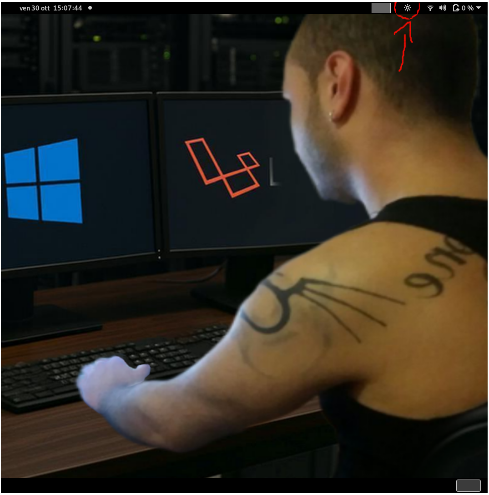
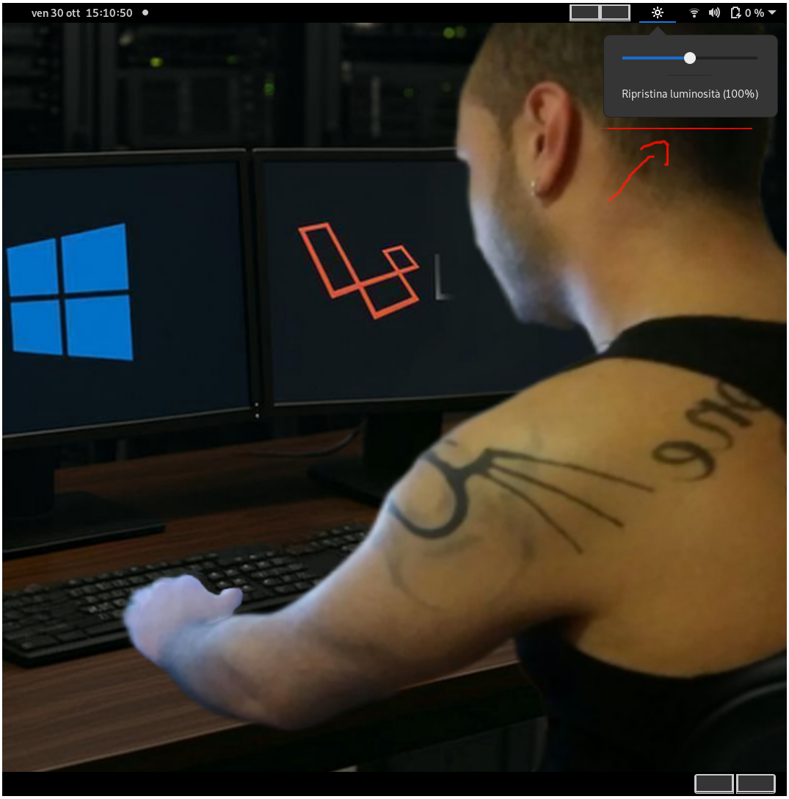
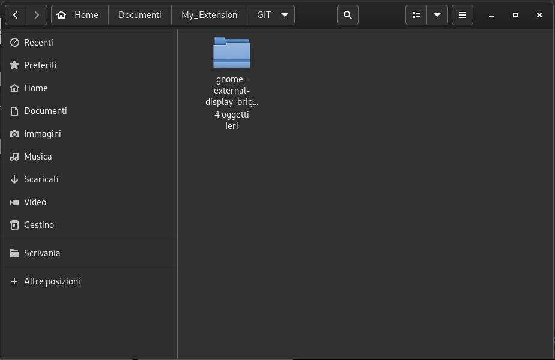
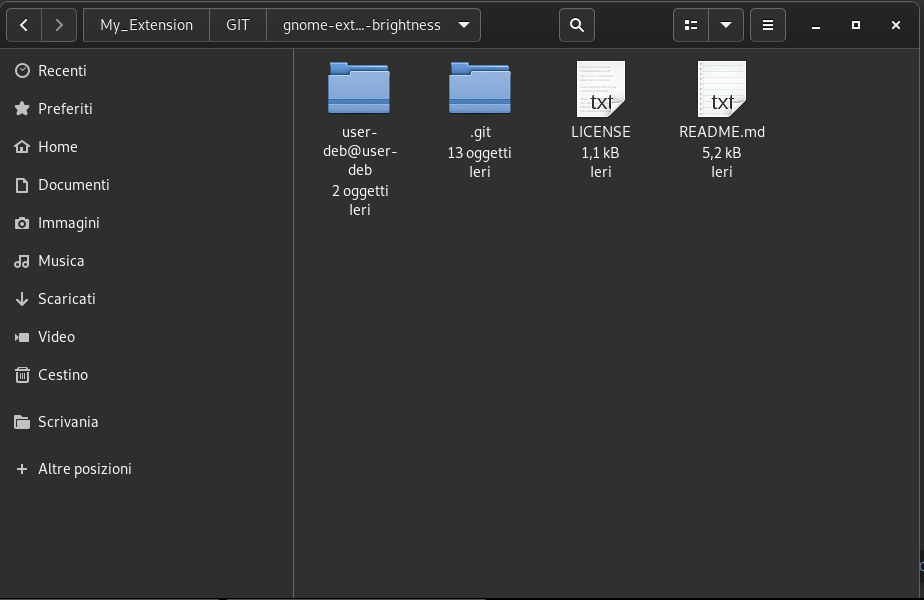
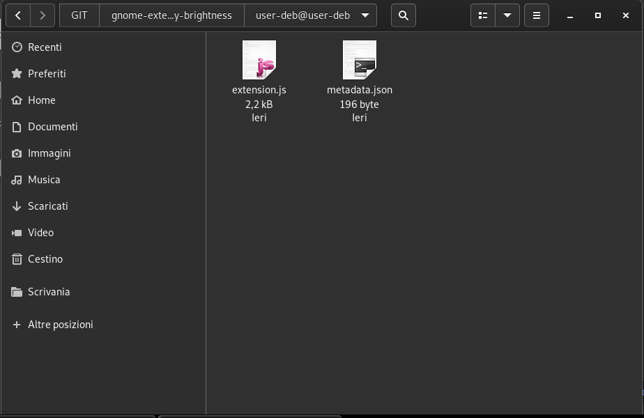

# gnome-external-display-brightness
Software brightness slider for external displays on GNOME Shell using xrandr.

### GNOME External Display Brightness

A GNOME Shell extension that provides a software brightness slider for an external display using xrandr.

# Requirements

- Linux with GNOME Shell.

- An X11 session.

- xrandr installed.

- An external display recognized by xrandr.

Tested on Debian 11 Bullseye with GNOME Shell 3.38.6. Other GNOME Shell versions may require changes to the extension code or metadata.

# Installation

1. Download the Extension

    Download or clone this repository from GitHub.
    If you download the repository as a ZIP archive, extract it first.

    Make sure the extension directory contains at least these files:

        user-deb@user-deb/ 
            ├── metadata.json 
            └── extension.js 

2. Install the Extension

    Copy the entire user-deb@user-deb directory, including metadata.json and extension.js, into the following directory in your home folder:

        ~/.local/share/gnome-shell/extensions/ 

    The final directory structure must be:

        ~/.local/share/gnome-shell/extensions/ 
            └── user-deb@user-deb/ 
                ├── metadata.json 
                └── extension.js 

    You can create the parent directory if it does not already exist:

        mkdir -p ~/.local/share/gnome-shell/extensions/ 

    Important: The extension directory name must exactly match the uuid value in metadata.json.

3. Configure the Display Output

    The extension uses xrandr to adjust the software brightness of a selected display. Output names differ between computers and graphics drivers.

    List the available display outputs:

        xrandr --query 

    Find the name of your connected display. Examples include VGA-1, HDMI-1, and DP-1.
    In extension.js, locate the DISPLAY_OUTPUT constant and set it to your actual display output name:

    const DISPLAY_OUTPUT = 'VGA-1'; 

    For example, if your display is named HDMI-1, change the value to:

        const DISPLAY_OUTPUT = 'HDMI-1'; 

    This configuration requires extension.js to define and use DISPLAY_OUTPUT in both xrandr commands.

4. Enable the Extension

    Run:

        gnome-extensions enable user-deb@user-deb 

    Check the extension status:

        gnome-extensions info user-deb@user-deb 

    If the extension does not appear immediately, log out and log back in.
    On an X11 session, you can also try restarting GNOME Shell by pressing Alt + F2, typing r, and pressing Enter. This method is not available on Wayland sessions.

5. Troubleshooting

    If the extension reports an error, inspect the GNOME Shell logs:

        journalctl --user -b --no-pager | grep -iE \ 'JS ERROR|TypeError|ReferenceError|SyntaxError' 

    Check that:

      - The directory is named user-deb@user-deb.

      - metadata.json contains the matching UUID.

      - The display output configured in extension.js exists in xrandr --query.

      - Your GNOME Shell version is compatible with the extension.

    Compatibility and Limitations

      - Tested on Debian 11 Bullseye with GNOME Shell 3.38.6.

      - Designed for X11 sessions; Wayland is not supported by this implementation.

      - Other GNOME Shell versions may require code or metadata changes.

      - Software brightness adjustment does not control the monitor's or television's physical backlight. It modifies the displayed image and may affect contrast or image quality.

      - Display support depends on the graphics driver and the functionality available through xrandr.

    Backup and Restore

    You can back up the extension directory to a USB drive, external disk, or compressed archive. After reinstalling Linux, you can restore the extension without rewriting its code.

    1. Back Up the Extension

      Create a compressed archive in your home directory:

          cd ~/.local/share/gnome-shell/extensions/ 
          tar -czf ~/brightness-extension-backup.tar.gz user-deb@user-deb 

      Copy brightness-extension-backup.tar.gz to a USB drive, external disk, or another safe location.

    2. Restore the Extension

      After reinstalling Linux, make sure GNOME Shell is installed and compatible with the extension.

      Copy the backup archive into your home directory, then run:

          mkdir -p ~/.local/share/gnome-shell/extensions/ 
          tar -xzf ~/brightness-extension-backup.tar.gz \ -C ~/.local/share/gnome-shell/extensions/ 

    3. Re-enable the Extension

      Run:

          gnome-extensions enable user-deb@user-deb 

      Check its status:

          gnome-extensions info user-deb@user-deb 

      If the extension does not start, log out and log back in, then inspect the logs using the troubleshooting command above.

    4. After Restoring

      If you install a different GNOME Shell version or change your display hardware, you may need to update metadata.json, the extension code, or DISPLAY_OUTPUT.
      Keep both the compressed archive and, if possible, a separate copy of the original extension directory.

## License

This project is licensed under the MIT License. See the `LICENSE` file for details.

Copyright (C) 2026 Alessio Erre.

 

 

